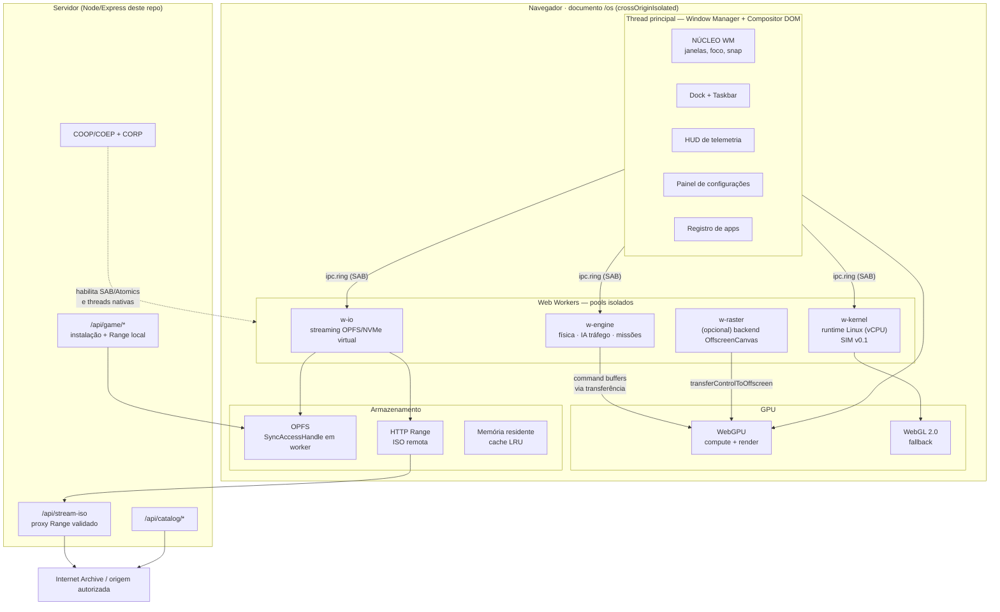

# NÚCLEO OS — Arquitetura Geral de Alto Nível

> **Documento 00 de 03.** Define a topologia, os contratos e os orçamentos de um
> *Virtual PC* que roda no navegador: um desktop multitarefa que hospeda (a) um
> runtime Linux/Debian, (b) um motor de jogo 3D de mundo aberto e (c) o launcher
> PS2/Play! que já existe neste repositório — todos dentro do mesmo documento HTML,
> sem reload, compartilhando GPU, memória e disco virtual.

---

## 0. Contrato de honestidade técnica

Arquitetura de elite começa distinguindo **plataforma** de **produto**. O navegador
é a plataforma; tudo abaixo é engenharia. As afirmações deste documento são
classificadas em três níveis:

| Marca | Significado |
|---|---|
| **[P]** Produção | Já existe no repositório e está exercitado (isolamento, Range, Play! WASM, catálogo). |
| **[B]** Base pronta | Código deste PR que funciona hoje: barramento `SharedArrayBuffer` + Atomics, VMFS sobre OPFS, telemetria real por worker, window manager, HUD. |
| **[R]** Roadmap | Especificado aqui, com critérios de aceite. Não está implementado — e o HUD **diz isso na tela** em vez de fingir. |

Nada de "hardware nativo": a meta declarada é **classe console** com metas
numéricas por perfil (§5). Qualquer número apresentado sem fonte de medição é
rotulado como *alvo*, nunca como resultado.

---

## 1. Diagrama de fluxo geral

> Versão vetorial (abre no GitHub e no visualizador): [`docs/02-diagrama-fluxo.svg`](02-diagrama-fluxo.svg).

### 1.1 Fluxo de execução (Mermaid)



### 1.2 Versão ASCII (para terminal, revisão de PR e leitura rápida)

```text
                    ┌─────────────────────────── documento /os ───────────────────────────┐
                    │  MAIN THREAD: NÚCLEO WM · Dock · HUD · Settings · App Registry      │
                    └───┬───────────────┬────────────────┬───────────────┬────────────────┘
      ipc.ring(SAB) ────┘               │                │               │
     ┌──────────────────┐   ┌───────────▼─────────┐  ┌───▼──────────┐  ┌─▼────────────────┐
     │ w-kernel         │   │ w-engine            │  │ w-io         │  │ w-raster (opc.)  │
     │ vCPU Linux (SIM) │   │ ECS · física · IA   │  │ OPFS · HTTP  │  │ OffscreenCanvas  │
     └────────┬─────────┘   └───────────┬─────────┘  └───┬──────────┘  └─┬────────────────┘
              │                         │                │               │
              └──────────────┬──────────┴────────────────┘               │
                             ▼                                           ▼
                    ┌────────────────────┐                    ┌──────────────────────┐
                    │  GPU: WebGPU       │◄───────────────────│  GPU: WebGL 2.0      │
                    │  compute + render  │      fallback bidirecional               │
                    └─────────┬──────────┘                    └──────────────────────┘
                              │
        ┌─────────────────────┴──────────────┬───────────────────────┐
        ▼                                    ▼                       ▼
  OPFS (NVMe virtual)               HTTP Range (ISOs)        Cache LRU em RAM
  SyncAccessHandle em worker        via proxy validado        (só para picos)
        │                                    │
        └────────────► /api/game/* ──► /api/stream-iso ──► origem autorizada
```

### 1.3 Ciclo de um quadro (60 Hz = 16,6 ms) — sequência canônica

```text
[1] rAF(main) ─► WM lê input pendente (pointer/teclado) e atualiza apenas geometria DOM
[2] rAF(main) ─► posts de comando para w-engine (delta time + input snapshot)   ~0,05 ms
[3] w-engine  ─► passo fixo de simulação 120 Hz acumulado → 2 ticks por quadro   8–13 ms (sim v0.1)
[4] w-engine  ─► enfileira draw list (instanced, bindless) no ring de GPU
[5] main      ─► WebGPU: compute culling → shadow → opaque → transparente → pós  orçamento 6–11 ms
[6] main      ─► HUD amostra métricas do último quadro (P50/P95, sem custo no frame)
[7] main      ─► telemetria agregada 2×/s (não a cada quadro) e publicada no HUD
```

Regra de ouro: **nenhum sistema bloqueia o frame**. Trabalho pesado é despachado
para worker ou para a GPU; o frame do compositor só monta a cena já resolvida.

---

## 2. Topologia de processos, threads e heap

| Unidade | Tipo | Responsabilidade | Heap alvo | Estado |
|---|---|---|---|---|
| `main` | thread de UI | WM, DOM, HUD, settings, dispatch de input | ≤ 96 MB | **[B]** |
| `w-kernel` | worker `module` | hospedar runtime Linux (vCPU, syscalls, console) | 256 MB–2 GB (WASM) | SIM **[B]**, real **[R]** |
| `w-engine` | worker `module` | ECS, passo fixo, IA de tráfego, missões, LOD streaming | 192 MB | SIM **[B]** |
| `w-io` | worker `module` | OPFS `SyncAccessHandle`, pipeline de assets, medição MB/s | 64 MB | **[B]** |
| `w-raster` | worker + `OffscreenCanvas` | raster de segundo canvas (miniaturas, mini-mapa) | 48 MB | **[R]** |
| *pthreads do núcleo* | workers internos do WASM | paralelismo do emulador (Play!) | do módulo | **[P]** |

**Regras de isolamento**

1. Um worker nunca toca o DOM. Comunicação só por `ipc.ring` (§3) ou `postMessage` com buffers transferíveis.
2. Nenhum `ArrayBuffer` grande cruza fronteiras: usamos *transfer* de `ArrayBuffer` (custo O(1)) ou *views* sobre `SharedArrayBuffer` (custo zero).
3. Workers de subsistema são **recriáveis**: falha isolada → o WM mostra "subsistema reiniciando", sem derrubar o desktop.
4. Todo `Emscripten` roda com `pthread` apenas quando `crossOriginIsolated === true`; caso contrário o núcleo cai para modo single-thread (`-s PTHREAD_POOL_SIZE=0`).

### 2.1 Escalonamento e prioridades

| Prioridade | Consumidor | Mecanismo |
|---|---|---|
| Crítica | frame do compositor | rAF; nenhuma tarefa > 4 ms no main |
| Alta | passo fixo do motor | `requestAnimationFrame` no worker via `setTimeout(0)` desacoplado, acumulador de tempo |
| Média | streaming de assets | `ReadableStream` + `MessageChannel`, com crédito de janela (não inundação) |
| Baixa | indexação de catálogo, pré-carga | `requestIdleCallback` no main, `MessageChannel` pausado por *backpressure* |

---

## 3. Barramento IPC — `ipc.ring` sobre `SharedArrayBuffer`

Contrato único para todas as fronteiras de thread. Implementado em `js/core/ipc.js`
e coberto por teste em `tests/core.mjs`.

### 3.1 Layout de memória (por canal)

```text
Int32Array control (32 slots = 128 B)
┌────┬──────────┬──────────┬───────────┬───────────┬────────────┬─────────┬─────────┐
│ 0  │ 1        │ 2        │ 3         │ 4         │ 5..7       │ 8..15   │ 16..31  │
│MAGIC│ head    │ tail     │ capacity  │ seq/drops │ reservado  │ stats   │ reserv. │
└────┴──────────┴──────────┴───────────┴───────────┴────────────┴─────────┴─────────┘
Uint8Array payload (capacity bytes, alinhado a 16 B)
┌──────────────────────────── quadro ────────────────────────────┐ ┌── próximo ──┐
│ u32 len │ u16 opcode │ u16 flags │ payload[len] │ pad p/ 16 B    │ │   ...       │
└────────────────────────────────────────────────────────────────┘ └─────────────┘
```

- Escrita: `Atomics.store(payload, …)` → `Atomics.store(control, TAIL, novo)` → `Atomics.notify`.
- Leitura: `Atomics.load(control, TAIL)` → copia → `Atomics.store(control, HEAD, …)`.
- **Alocação zero no caminho quente**: buffers pré-alocados, sem `JSON`, sem cópia intermediária.
- *Backpressure*: se `(tail + tam + 16) % capacity === head`, o produtor aplica *spin* com
  `Atomics.wait` por no máximo 2 ms e, se ainda cheio, incrementa `drops` e devolve erro
  ao chamador — jamais bloqueia o frame.

### 3.2 Catálogo de opcodes (trecho)

| Código | Nome | Direção | Payload |
|---|---|---|---|
| `0x01` | `HB` | worker → main | `u32 ts` + estado |
| `0x10` | `TICK` | main → engine | `u16 dt_ms`, `u32 input_bits` |
| `0x11` | `TICK_REPORT` | engine → main | `u16 ms_sim`, `u16 ms_ia`, `u32 entidades` |
| `0x20` | `BLK_READ` | main → io | `u32 offset`, `u32 len` |
| `0x21` | `BLK_DATA` | io → main | bytes + `u32 ms` |
| `0x30` | `SYS_EXEC` | main → kernel | comando NUL-terminado |
| `0x31` | `SYS_STDOUT` | kernel → main | texto + código de saída |

### 3.3 Degradação

Sem `SharedArrayBuffer` (página não isolada), `ipc.create()` devolve um transporte de
`postMessage` com **a mesma API** (`write/read/onMessage/stats`). O sistema continua
funcional, com latência maior e sem `Atomics.wait`; a UI marca o barramento como
`TRANSPORTE: MESSAGE` em vez de `RING/SAB`.

---

## 4. Realidade da plataforma (mito × engenharia)

| Capacidade | Realidade 2026 | Decisão de arquitetura |
|---|---|---|
| **WASM 64-bit (`memory64`)** | Especificado, com suporte parcial; *não* é o caminho padrão dos navegadores nem dos toolchains Emscripten/Clang mainstream. | Assumir **wasm32** com memória máxima prática de 2–4 GB e *heap growth* explícito. Isolar o runtime Linux em worker próprio para que o limite não mate o desktop. |
| **Threads WASM + SIMD** | Disponíveis com `SharedArrayBuffer`; SIMD (`-msimd128`) estável. | Emscripten com `-pthread -msimd128 -O3 -flto`; exigir COOP/COEP (já garantido pelo `server.js` **[P]**). |
| **WebGPU compute** | Estável em Chromium e Safari; disponível no Firefox moderno. Tipos `f16/f32`; **não existe `f64` em WGSL**. | Física de partículas/fluidos e culling na GPU. Simulação determinística canônica continua na CPU (float64) e a GPU só interpola/renderiza. |
| **WebGL 2.0** | Onipresente. | Fallback com teto de recursos (sem compute → partículas em `transform feedback` ou CPU). |
| **OPFS + `SyncAccessHandle`** | `SyncAccessHandle` é exclusivo de worker (dedicado); no main só a API assíncrona. | Todas as E/S do disco virtual acontecem em `w-io`; main pede setores pelo ring. |
| **`backdrop-filter`** | Bom, mas caro em áreas grandes com blur alto. | Limitar blur a `blur(18px)` em superfícies ≤ 1,5 M px; janelas maximizadas caem para *tint* sólido (ver Design System §2). |
| **`performance.memory`** | Só Chromium; não é padrão. | Telemetria mostra heap quando disponível e `—` rotulado quando não; nunca inventa número. |
| **GPU timer queries (`timestamp-query`)** | WebGPU: recurso opcional. | Usar quando existir; senão medir CPU-side do submit e marcar a métrica como `CPU sub`. |
| **Emular x86_64 completo com desempenho "nativo"** | Fisicamente impossível: cada instrução x86 custa tradução + sanitização. Teto realista de ambiente gráfico leve. | Expectativa honesta: **console/desktop leve**, não workstation. `w-kernel` é orçado em 1–4 vCPU lógicas e 512 MB–2 GB. |
| **"GTA V no navegador"** | Nenhum motor AAA é portável sem código-fonte; e nós não distribuímos assets de terceiros. | Motor próprio estilo *open-world* (ECS + streaming por células) **[R]**, e o mundo do GTA:SA **real** via Play!/PS2 **[P]** em janela do OS. |

---

## 5. Orçamentos de recursos (o contrato de performance)

### 5.1 Perfis de qualidade

| Perfil | Render | FPS alvo | VRAM (tex+geo) | RAM total | Escala | Sub-amostragem |
|---|---|---|---|---|---|---|
| `baseline` | 540p → upscale bilinear | 30 travado | 180 MB | ≤ 1,2 GB | 0,5× | sombras desligadas, LOD agressivo |
| `balanced` | 720p → upscale | 45–60 | 420 MB | ≤ 2,0 GB | 0,72× | sombra 1024², 1 passe de pós |
| `ultra` | nativo até 1080p | 60 (teto monitor) | 900 MB | ≤ 3,4 GB | 1,0× | sombra 2048² + computa partículas |

Resolução dinâmica (*DRS*): se P95 do frame > orçamento por 60 quadros, a escala cai 0,05× (piso 0,4×); subir só após 300 quadros estáveis — histerese assimétrica evita *oscillation*.

### 5.2 Orçamento por quadro

| Estágio | 60 Hz (16,6 ms) | 30 Hz (33,3 ms) | Observação |
|---|---|---|---|
| Input + WM (main) | 0,8 ms | 1,2 ms | só geometria; nunca layout completo |
| Simulação (`w-engine`) | 4,0 ms | 8,0 ms | fora do frame do compositor; aparece como latência |
| Culling compute | 0,6 ms | 1,0 ms | frustum + occlusion em `w-engine`/GPU |
| Shadow map | 1,6 ms | 3,0 ms | desligável |
| G-buffer + opacos | 4,2 ms | 9,0 ms | bindless, instancing |
| Transparentes + partículas | 2,0 ms | 4,5 ms | compute na GPU |
| Pós (bloom/TAA/tonemap) | 1,8 ms | 4,0 ms | 1 passe no perfil balanceado |
| HUD + DOM | 0,7 ms | 1,0 ms | texto em canvas offscreen, DOM só para painéis |
| **Margem** | **0,9 ms** | **1,6 ms** | reserva para GC e picos do SO |

### 5.3 Contenção de garbage collector

1. Nenhum objeto por frame: `Float32Array`/`Int32Array` pré-alocados, *pools* de entidades e de draw list.
2. Sem `Array.prototype.map/filter` no laço quente; `for` indexado sobre arrays planares (SoA).
3. Strings só na fronteira de UI (terminal, HUD), com *ring* de linhas fixo e `textContent`.
4. Fronteiras de worker só trafegam bytes; nada de objetos com `JSON.stringify`.
5. Medição contínua: o HUD mostra P95 do frame — se subir sem pico de simulação, o suspeito é GC.

---

## 6. Subsistema Linux/Debian

### 6.1 Cadeia de decisão (a adotar, em ordem de preferência)

| Opção | Natureza | Prós | Contras | Veredito |
|---|---|---|---|---|
| **Play! (já no repo)** | Emulador PS2 em WASM **[P]** | Já funciona aqui, com CDVD por HTTP Range e pthreads | Emula PS2, não x86 Linux | **Linha de produto A** — o "console" do OS |
| **v86** | Emulador x86 em WASM/JS | Código aberto, roda Debian/ReactOS, salva estado | Desempenho modesto (sem GPU real) | **Linha de produto B** — terminal + TUI |
| **CheerpX** | Virtualizador x86 com JIT próprio | Debian 12 com bom desempenho, requer COOP/COEP | Binário/licença comercial para uso além de avaliação | **Avaliar licença** antes de integrar |
| **JSLinux** | Emulador didático | Simples, ótimo para smoke test | Sem SMP, lento | Referência de teste apenas |

O runtime entra em `w-kernel` por um **adaptador comum** (`mountRuntime({onStdout, onFrame, feed, resize})`),
de modo que trocar v86 por CheerpX não toca o WM nem o terminal.

### 6.2 Cadeia de boot

```text
POST /os  →  checagens de capacidade (SAB, WebGPU, OPFS, cota)
          →  monta VMFS (/etc /usr /home /var /mnt/nucleo)
          →  spawn w-kernel, carrega imagem do runtime (.wasm + initrd)
          →  console: systemd-less init → getty → login simbólico
          →  janela "Debian" publica framebuffer (canvas) + pty (ring 0x30/0x31)
```

Rede: `w-kernel` fala com `w-net` por WebSocket; DNS/TCP são emulados por um *shim*
que só permite destinos autorizados (mesma política de *allowlist* do `server.js` **[P]**).
WebRTC entra apenas para transporte quando o servidor expõe `datachannel` — nunca para furar bloqueios.

### 6.2.1 Entrada de dados (o que já existe)

O subsistema Linux **não** tem `apt` hoje: sem runtime de verdade não há gerenciador de pacotes, e
um `apt` simulado seria mentira. O caminho de entrada de dados, porém, já está construído e
testado — `js/core/import.js` instala arquivos do computador real no VMFS (arrastar-e-soltar,
paleta, janela Arquivos e comando `install` no terminal), com sanitização de nome, colisão sem
sobrescrita e cota verificada antes da escrita.

Quando o runtime entrar (F4), o rootfs Debian chega pelo **mesmo** instalador: o disco já é o do
convidado, então não há caminho novo a inventar — apenas um consumidor novo para o mesmo contrato.

### 6.2.2 Navegador do sistema (modo texto) — o que dá para ter agora

Rede dentro de uma página `crossOriginIsolated` é um problema de engenharia com duas metades:

```text
                             ┌─ iframe apontando para o site ──────────────┐
pedido do usuário            │  X-Frame-Options / frame-ancestors recusam  │  → área branca
"abrir site.com"             │  e a COEP require-corp bloqueia a origem    │
                             └─────────────────────────────────────────────┘
                             ┌─ proxy no host + renderização no cliente ──┐
                             │  /api/fetch  → política → DNS → redirects   │
                             │  htmltext.js → linhas + segmentos clicáveis │  → funciona hoje
                             │  histórico, endereço, salvar em ~/Downloads │
                             └─────────────────────────────────────────────┘
```

**Módulos.** `js/core/fetchpolicy.js` (política pura, sem I/O — testável por tabela),
`server/fetch-route.js` (rota `/api/fetch`, com `fetch`/`lookup` injetáveis),
`js/core/htmltext.js` (HTML → texto, `DOMParser` injetado) e `js/apps/browser.js` (a janela).

**Fronteira de confiança.** O servidor passa a ser um proxy de leitura, e um proxy é a superfície
mais perigosa do sistema: por isso as decisões estão em um módulo puro e **cada salto de
redirecionamento é validado de novo** (seguir `Location` automaticamente é como um proxy deixa de
ser seguro). Cadeia: esquema → credenciais → porta (80/443, denylist de serviços internos) → nome
local (`localhost`, `.local`, `.internal`) → IPv4/IPv6 literais (incluindo `::ffff:0:0/96` nas
formas decimal **e** hexadecimal, via `expandV6`) → DNS → tetos de 2 MiB (texto) / 8 MiB (bruto) e
timeout de 15 s. Resíduos declarados: DNS rebinding (checagem é pré-conexão) e NAT64
`64:ff9b::/96`. Mitigação: o servidor é de uso local e o README diz isso.

**Representação.** A página vira `{ title, lines, links, base }`, onde cada linha tem
`segments: [{ text, href }]` — uma frase com um link continua **uma linha**, e só o trecho do link
é clicável. É essa escolha que separa um leitor de texto usável de uma lista de fragmentos.

**Limites declarados na interface.** 4000 linhas por página (com aviso), sem CSS/layout/imagens
pintadas e sem JavaScript do site. O navegador **diz** que é modo texto; não existe tentativa de
parecer um motor gráfico. F4 entregaria o item 1 do menu de opções (navegador real dentro do Linux
emulado); até lá, este é o caminho honesto.

### 6.3 Critérios de aceite do subsistema

- `uname -a` e `cat /etc/debian_version` respondem **do guest**, não da UI. **[R]**
- `apt` funcionando em modo offline (pacotes pré-carregados em OPFS). **[R]**
- P95 de latência de teclado ≤ 40 ms medido no HUD. **[R]**
- Matar `w-kernel` deixa o desktop vivo e oferece "reiniciar subsistema". **[B]**

---

## 7. Subsistema de jogo (motor estilo mundo aberto)

### 7.1 Núcleo do motor

| Sistema | Implementação | Thread/GPU |
|---|---|---|
| ECS | *archetypes* em `Float32Array`, entidades por *id* estável (u32) | `w-engine` |
| Mundo | células 256 m × 256 m; LOD geo-mipmap; streaming por raio + direção de movimento | `w-io` + `w-engine` |
| Física | passo fixo 120 Hz, *broadphase* por *grid* uniforme, contatos resolvidos com solver iterativo | `w-engine` (CPU canônica) |
| Partículas/tecido/fumaça | compute WGSL (SSBO) | GPU |
| Tráfego/IA | *steering behaviors* + grafo de vias; só IA num raio de 180 m, resto em LOD de rota | `w-engine` |
| Missões | máquina de estados por grafo dirigido; persistida no VMFS (`/home/nucleo/saves`) | main + VMFS |
| Culling | frustum no plano da câmera + *HiZ occlusion* acumulada | GPU compute |
| Áudio | WebAudio com *voice pool* limitado; DSP de reverb em `w-engine` | main |

### 7.2 Build C/C++ (Emscripten)

```sh
emcc engine/*.cpp \
  -O3 -flto -fno-exceptions -fno-rtti \
  -msimd128 -msse4.2 -pthread \
  -s WASM=1 -s MODULARIZE=1 -s EXPORT_ES6=1 \
  -s ENVIRONMENT=web,worker -s ALLOW_MEMORY_GROWTH=1 \
  -s INITIAL_MEMORY=192MB -s MAXIMUM_MEMORY=2GB \
  -s PTHREAD_POOL_SIZE=navigator.hardwareConcurrency \
  -s USE_PTHREADS=1 -s PROXY_TO_PTHREAD=1 \
  -s ASSERTIONS=0 -s MALLOC=emmalloc -s STACK_SIZE=2MB \
  -s EXPORTED_FUNCTIONS='["_engine_init","_engine_tick","_engine_push_input","_malloc","_free"]' \
  -o dist/engine.js
```

- `-s MALLOC=emmalloc`: alocador leve, menos fragmentação para o padrão *zero-allocation*.
- `PROXY_TO_PTHREAD`: mantém a thread de UI livre — regra de ouro §1.3.
- Perfis de build: `release-fast` (sem asserts), `debug` (`-O1 -g3 -sASSERTIONS=2 -fsanitize=undefined`), `profile` (`-O2 -sPROFILING_FUNCS`).

### 7.3 Pipeline de assets

```text
fonte (.gltf/.fbx/.png/HDR) → meshopt (geometria) → KTX2+BasisU (texturas)
   → chunk por célula do mundo (.s3c) → manifesto binário + índices
   → OPFS: /var/nucleo/game/cell_XX_YY.s3c   (leitura por SyncAccessHandle)
```

Sem dependência de rede no runtime do jogo: o mundo é servido do disco virtual
local, com *prefetch* preditivo de 2 células à frente do vetor de velocidade.

### 7.4 Licenciamento e conteúdo

Nenhum asset de terceiros é distribuído (§0 do `README.md`). O motor é original; o
conteúdo do usuário entra por upload local para OPFS ou por ISO de PS2 montada pelo
runtime **[P]**. Isso é requisito de arquitetura, não nota de rodapé: o instalador do
jogo é um serviço do OS, com verificação de integridade e cota de disco.

---

## 8. Renderização

### 8.1 Pipeline WebGPU

```text
[Compute] frustum cull + LOD select + HiZ build
   → [Compute] compactação da draw list (indirect)
   → [Render] shadow map (CSM 2 cascatas no balanced)
   → [Render] opacos (bindless: 1 descriptor array, sem rebind por objeto)
   → [Compute] simulação de partículas (SSBO ping-pong)
   → [Render] transparentes + volumétricos leves
   → [Render] pós: tonemap ACES → TAA leve → bloom (1/4 res) → dithering
   → [Present] canvas do HUD composto no documento pelo compositor do navegador
```

### 8.2 Orçamento de VRAM (perfil `balanced`, 420 MB)

| Recurso | Tamanho | Formato |
|---|---|---|
| Texturas de terreno | 140 MB | KTX2/Basis (transcodificado na GPU) |
| Props + personagens | 90 MB | meshopt, *vertex compression* |
| Shadow atlas | 32 MB | D32 + R16 |
| Buffers de frame (HDR) | 48 MB | RGBA16F, 720p |
| SSBOs (partículas, instâncias) | 40 MB | storage |
| Reserva do compositor/navegador | 70 MB | — |

### 8.3 Fallback WebGL 2.0

Diferenças obrigatórias a declarar na UI: sem compute (culling no worker), sem bindless
(binding por *bucket* de material, ≤ 512 draw calls/quadro), sem `f16` (texturas
`RGBA8` com dithering), TAA substituído por FXAA. O HUD mostra `BACKEND: WEBGL2` e
o perfil máximo é rebaixado para `balanced`.

---

## 9. Armazenamento — NVMe virtual em OPFS

### 9.1 Layout de partições

| Caminho VMFS | Uso | Cota |
|---|---|---|
| `/boot` | kernel/initrd do runtime Linux | 64 MB |
| `/etc`,`/usr`,`/var` | rootfs do guest | 2 GB |
| `/home/nucleo` | usuário, saves, projetos | 1 GB |
| `/var/nucleo/game` | células do mundo + texturas | 4 GB |
| `/mnt/nucleo` | montagens (ISO local via `File`/`Blob`) | efêmera |

### 9.2 Regras de E/S

1. `SyncAccessHandle` só em `w-io`; main nunca abre arquivo grande directamente.
2. Gravamos por *chunks* de 1 MiB com `flush()` e *journal* simples (`.jrn`) para
   sobreviver a fechamento abrupto; *fsync* a cada N=8 chunks.
3. `navigator.storage.estimate()` alimenta o *gauge* de disco do HUD; a 90% da cota o
   OS oferece *eviction* do cache (nunca do perfil do usuário) com confirmação.
4. Em `StorageManager.persist()` negado, o OS avisa que o armazenamento é "melhor esforço".
5. **Fallback**: sem OPFS → IndexedDB → memória (com banner explícito `DISCO: VOLÁTIL`).

---

## 10. Telemetria

| Métrica | Fonte | Custo | Honestidade |
|---|---|---|---|
| FPS / frame P50-P95 | rAF delta + histograma circular | ~0 | Real |
| Sim ms/tick (`w-engine`) | `performance.now()` dentro do worker | ~0 | Real |
| Kernel ms/tick (`w-kernel`) | idem | ~0 | Real (carga = SIM) |
| OPFS MB/s e IOPS | bytes/ms em `w-io` | ~0 | Real |
| Heap JS | `performance.memory` (Chromium) | ~0 | Rotulado quando ausente |
| Cota de disco | `storage.estimate()` | ~0 (2 s) | Real |
| GPU frame ms | `timestamp-query` se habilitado; senão marco CPU no *submit* | baixo | Rotulado `CPU sub` quando aproximado |
| VRAM | **não exposta pelo navegador** | — | HUD mostra soma das alocações *declaradas* pelo nosso alocador, com marca `ESTIMADA` |
| Temperatura/energia | inacessível | — | Não existe. Não inventamos. |

Baterias de alerta: verde < 70% do orçamento, âmbar 70–92%, vermelho > 92%; dois
estados extras usados em produção: `STALL` (métrica congelada > 1 s) e `N/D`.

---

## 11. Matriz de resiliência (falha → resposta)

| Falha | Detecção | Resposta automática | Estado na UI |
|---|---|---|---|
| `SharedArrayBuffer` indisponível | `crossOriginIsolated === false` | transporte `postMessage`, aviso de desempenho | borda âmbar + banner |
| Erro de contexto WebGPU | `device.lost` | recria device 2×, depois cai para WebGL2 | toast + badge de backend |
| Contexto WebGL perdido | `webglcontextlost` | aguarda `restored`, re-sobe recursos do disco | janela em cinza, "restaurando" |
| OOM do worker do kernel | `RangeError` de alocação | reinicia `w-kernel` com `MAXIMUM_MEMORY` menor (−25%) | banner "subsistema reiniciado" |
| Estouro de cota OPFS | `QuotaExceededError` | pausa escrita, propõe eviction | modal com escolha |
| Disco de PS2: falha de leitura | resposta sem `206` | *backoff* + subchunk; parada limpa sem setores falsos **[P]** | erro na janela |
| Frame em *stall* > 3 s | watchdog do HUD | pausa simulação, oferece baixar perfil | overlay de diagnóstico |
| Worker morto (`onerror`) | `error`/`messageerror` | respawn com estado do journal, log no terminal | LED vermelho no HUD |
| Sem `navigator.gpu` | probe no boot | perfil `balanced` travado, backend WebGL2 | token `WEBGL2` |
| Sem `File System Access` (Safari antigo) | probe | entrada de ISO via *stream* HTTP Range **[P]** | aviso no app PS2 |
| Perda de foco/aba em background | `visibilitychange` | simulação pausa, I/O continua em ritmo baixo | HUD em `IDLE` |
| Rede lenta na ISO | P95 de leitura > 250 ms | reduz *lookahead*, aumenta cache LRU | indicador no app PS2 |
| Token/cota de GPU (contexto por aba) | recusa de criação | modo headless de janela (só terminal) | toast |
| Corrupção de arquivo no VMFS | checksum por chunk | isola chunk, restaura do `.jrn` | log no terminal |

---

## 12. Segurança e cadeia de suprimentos

- **Isolamento**: `COOP/COEP/CORP` no `server.js` **[P]**; o OS só aceita rodar isolado e diz isso ao usuário quando não está.
- **Sem `eval`/`innerHTML` com dados de usuário**: terminal escreve por `textContent`; nomes de arquivo são validados por `core/util.js` (sem `..`, sem NUL).
- **Origem remota**: o backend só aceita `https://archive.org` (e subdomínios) com validação de `Content-Range` **[P]** — não é proxy de URL arbitrária.
- **Sem credenciais**: nada é pedido ou armazenado; o OS não guarda token de ninguém.
- **Integridade**: binários WASM de terceiros (Play!) com licença e `provenance.json` **[P]**; todo asset novo deve entrar com hash e licença no mesmo padrão.
- **CSP**: `default-src 'self'`; fontes locais; nenhum script de CDN no runtime do OS.

---

## 13. Pipeline de build e CI

```text
npm ci
  ├─ node --check (server, instalador, catálogo)
  ├─ npm run test:core    ← barramento SAB, VFS, geometria do WM (Node puro)
  ├─ npm run test:catalog
  └─ npm run test:installer
      (CI: .github/workflows/ci.yml)

npm start  → hub:  /        painel PS2 (NÚCLEO // PS2 NEXUS)
                    /os      Virtual PC (NÚCLEO OS)   ← este PR
npx playwright install chromium && npm run test:browser   (local, browser real)
```

Versionamento: `os/` é servido como módulos ES nativos, sem bundler no caminho
crítico (a arquitetura só precisa de *bundling* quando o `.wasm` do motor entrar,
e aí o hash de conteúdo governa o cache). Sem CDN, sem etapa obrigatória de build.

---

## 14. Roadmap com critérios de aceite

| Fase | Entrega | Critério de aceite (mensurável) | Estado |
|---|---|---|---|
| **F0** | Shell: boot, WM, dock, HUD, settings, terminal VMFS | `/os` carrega isolado; abrir/fechar/maximizar 4 janelas sem queda de frame > 2×; `test:os-core` verde | **[B]** feito |
| **F1** | Barramento real + 3 workers instrumentados | ring SAB com 0 *drops* a 2 000 msg/s; P95 do main < 2 ms com 3 workers ativos | **[B]** feito |
| **F2** | Integração do launcher PS2 como janela do OS | GTA:SA boota dentro de uma janela; fechar a janela encerra VM/pthreads/áudio sem vazar **[P]** | **[B]** feito (ponte reusada) |
| **F3** | Motor de jogo: ECS + mundo em células + streaming OPFS | 1 km² de mundo, 60 FPS no perfil `baseline`, 30 fps com 2 000 entidades | **[R]** |
| **F4** | Runtime Linux real em `w-kernel` | boot de Debian com TTY interativo; P95 de teclado ≤ 40 ms; `apt` offline | **[R]** |
| **F5** | Compute pesado na GPU + DRS | partículas de 500 k pontos a 2,0 ms; DRS estabilizado sem oscilar > 1 passo | **[R]** |

Regra de fase: uma fase só fecha quando o critério é medido **no HUD ou em teste
automatizado**, não quando "parece funcionar".

---

## 15. Riscos principais

| Risco | Probabilidade | Impacto | Mitigação |
|---|---|---|---|
| Teto de memória do wasm32 no runtime Linux | Alta | Alto | worker dedicado, `MAXIMUM_MEMORY` configurável, rootfs enxuto, swap em OPFS (lento, mas não mata) |
| `backdrop-filter` derrubando o frame em telas 4K | Média | Médio | teto de área com blur; degradação para *tint* (§Design System) |
| Licença do virtualizador x86 | Média | Alto | manter adaptador plugável; F4 pode usar v86 puro |
| Fragmentação de suporte a WebGPU | Média | Médio | fallback WebGL2 de primeira classe, com perfil rebaixado |
| Pressão de GPU por múltiplos canvases (jogo + PS2 + terminal) | Alta | Médio | orçamento de canvas, suspensão automática de janela minimizada/oculta |
| Complexidade de sincronização SAB (condições de corrida) | Média | Alto | `Atomics` apenas em inteiros alinhados, um escritor por canal, testes de estresse |
| Cota de armazenamento (eviction do navegador) | Média | Alto | `persist()`, journal, política de eviction, aviso ao usuário |
| Escopo ("tudo ao mesmo tempo") | Alta | Alto | fases F0–F5 com critério medido; nada entra sem instrumentação |

---

## 16. Glossário operacional

- **VMFS** — sistema de arquivos virtual do OS sobre OPFS (não é o sistema do guest Linux; é o disco do PC virtual).
- **Ring** — canal de mensagens de tamanho fixo sobre `SharedArrayBuffer`.
- **Backpressure** — crédito de janela que impede o produtor de inundar o consumidor.
- **DRS** — *Dynamic Resolution Scaling*.
- **HiZ** — pirâmide hierárquica de profundidade usada para *occlusion culling*.
- **SoA** — *Structure of Arrays*, layout planar para cache e SIMD.
- **SIM** — subsistema cuja **carga** é sintética; a infraestrutura em volta (barramento, workers, telemetria) é real e é isso que a fase valida.
